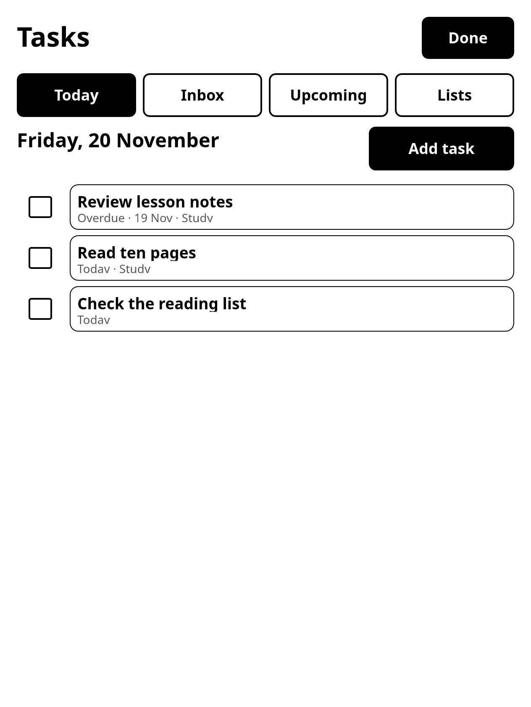
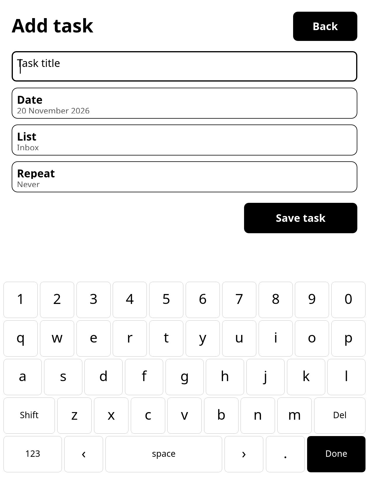
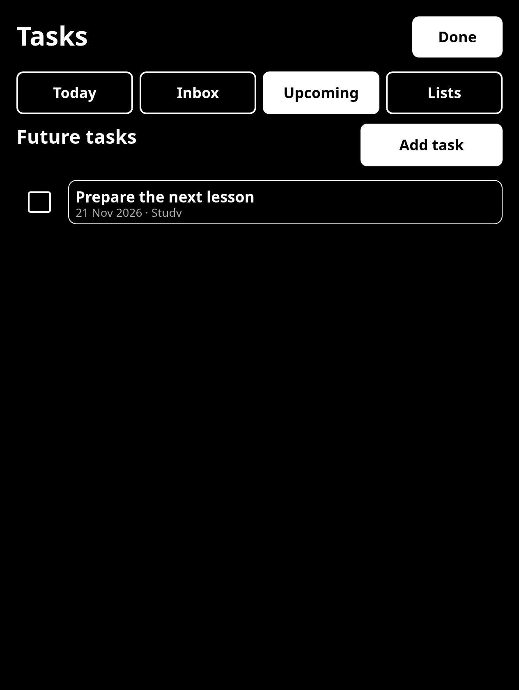

# Tasks for Kindle

A local daily planner for PrimitiveOS. Open Today for overdue and due tasks, or switch to Inbox, Upcoming, or your named lists.

<table>
  <tr>
    <td align="center"><br><sub>Today with due and overdue tasks</sub></td>
    <td align="center"><br><sub>Task details with the shared keyboard</sub></td>
    <td align="center"><br><sub>Upcoming tasks in dark mode</sub></td>
  </tr>
</table>

The screenshots are from the desktop simulator.

## How to use it

- Tap **Add task** and enter a title. Date, list, and repeat are optional.
- Create named lists under **Lists**. Tap a task title to change its details.
- Tap the checkbox to complete a task. Use **Undo** to reverse the most recent completion.
- Choose daily, weekdays, or weekly repeat. An overdue occurrence moves forward to its next scheduled date when you complete it.

Tasks and your last completion are saved on the Kindle. Dates use the device’s local calendar.

## Install

Open **Store** from Primitive Launcher and look for **Tasks**. [Install guide](INSTALL.md)

## Simulate on a computer

Keep [PrimitiveOS Tools](https://github.com/PrimitiveOS/kindle-primtitive-tools) and
[Primitive Launcher](https://github.com/PrimitiveOS/kindle-primitive-launcher) beside this repository.

```sh
cargo test --offline --locked --workspace
cargo run --offline --locked -p tasks-desktop -- build/previews
```

## Licence

App code is licensed under [PolyForm Noncommercial 1.0.0](LICENSE).
Original artwork, documentation, and screenshots use [CC BY-NC-SA 4.0](LICENSE-DOCS).
Chrono date handling uses the [upstream licence](licenses/chrono-LICENSE.txt).
